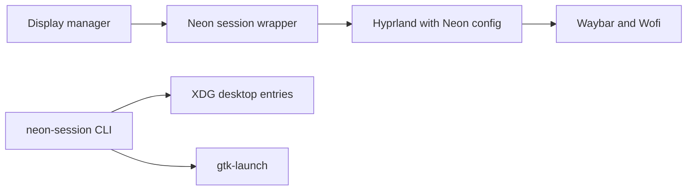

# Architecture

The Cargo workspace currently has `neon-core` for XDG desktop application discovery and `neon-session` for CLI launch integration. A separate, Neon-owned Hyprland config starts the preview session. Existing user Hyprland configuration is never sourced.

Future shell surfaces should communicate through a compositor adapter. Hyprland IPC is the initial adapter; Smithay remains a separate experimental track. No custom compositor exists yet.
